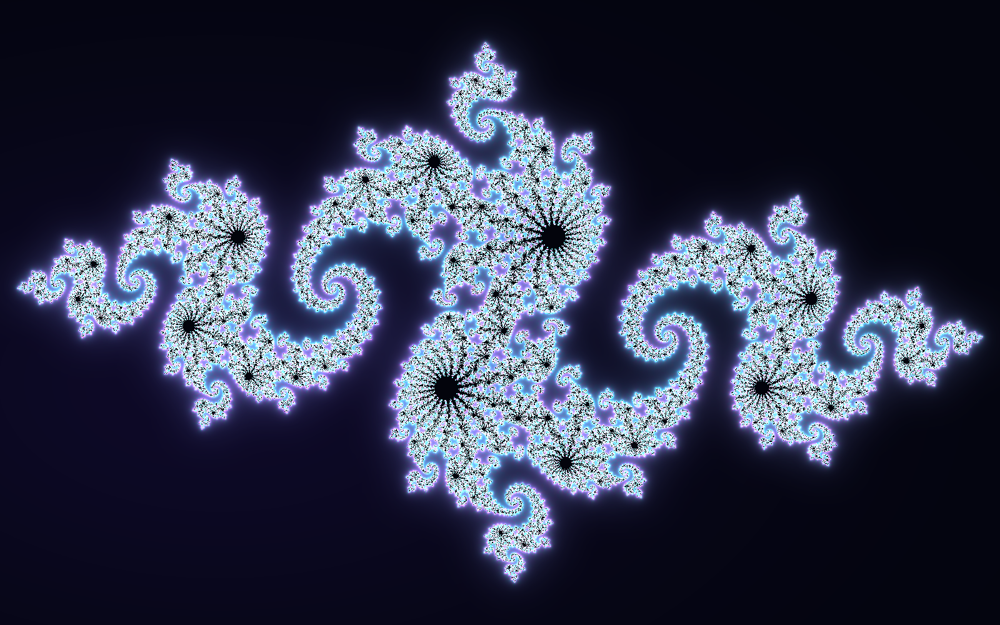
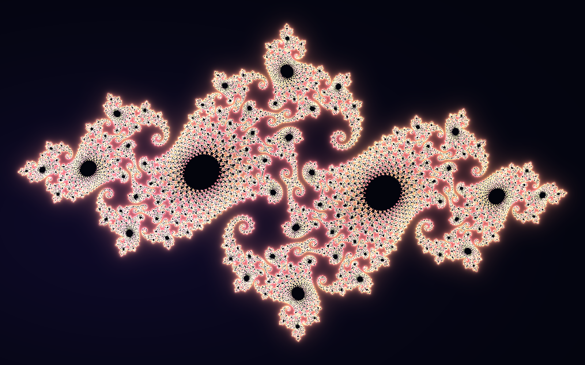

# FRACTAL PORTAL — Mathematical Julia Set Art

[](https://github.com/TimurSlavinskiy/fractal-portal/actions/workflows/fractal-check.yml)

**A Python project that turns complex-number equations into high-resolution artwork.** The rendered images are computed procedurally pixel by pixel — no image-generation models, image downloads, or 3D assets are used for the artwork.

## Gallery

### Aurora — neon spirals



### Ember — fiery fractal branches



Both example images are **1600 × 1000 PNG** files generated by the included Python program.

## The mathematics

For each pixel, its position represents an initial complex number, $z_0$. The program repeatedly evaluates the Julia-set iteration:

$$z_{n+1} = z_n^2 + c$$

The complex constant $c$ controls the geometry of the fractal. The renderer uses an escape-time measure, derivative-based distance estimate, smooth color palettes, and mathematical glow calculations. Changing $c$ produces a different pattern, while changing the palette changes the colors.

The examples use:

| Artwork | Complex constant $c$ | Palette |
| --- | --- | --- |
| Aurora | $-0.8 + 0.156i$ | `aurora` |
| Ember | $-0.74543 + 0.11301i$ | `ember` |

## Run locally

Install **Python 3.10+**, then run:

```bash
python -m pip install -r requirements.txt
python fractal_portal.py --preset aurora --output fractal_aurora.png
python fractal_portal.py --preset ember --output fractal_ember.png
```

On Windows, you can also double-click `RUN_FRACTAL_WINDOWS.bat` to install dependencies and render the presets.

### Create your own fractal

```bash
python fractal_portal.py --real -0.70176 --imag -0.3842 --palette coral --zoom 1.3 --output my_fractal.png
```

For a larger PNG:

```bash
python fractal_portal.py --preset aurora --width 1920 --height 1080 --supersample 2 --output fractal_hd.png
```

Options include `--real`, `--imag`, `--palette`, `--zoom`, `--iterations`, `--center-x`, `--center-y`, `--width`, `--height`, and `--supersample`.

## Automated verification

```bash
python -m unittest -v test_fractal
```

The test suite verifies PNG output, reproducibility, and that different complex constants change the image. GitHub Actions runs this test suite on pushes and pull requests. Results are visible in the [Actions tab](https://github.com/TimurSlavinskiy/fractal-portal/actions).

## Project structure

- `fractal_portal.py` — the math renderer and command-line interface
- `fractal_aurora.png` and `fractal_ember.png` — generated artwork
- `test_fractal.py` — automated tests
- `requirements.txt` — Python dependencies (NumPy and Pillow)
- `RUN_FRACTAL_WINDOWS.bat` — Windows shortcut
- `.github/workflows/fractal-check.yml` — continuous integration

## Attribution and scope

The images are algorithmic visualizations, not photographs or physically exact simulations. The image pixels are generated by mathematical code; the code was developed with AI assistance.

## License

MIT License — see [`LICENSE`](LICENSE).
